<p align="center">
  <picture>
    <source media="(prefers-color-scheme: dark)" srcset="assets/brand/hipso-logo-completo-blanco.svg">
    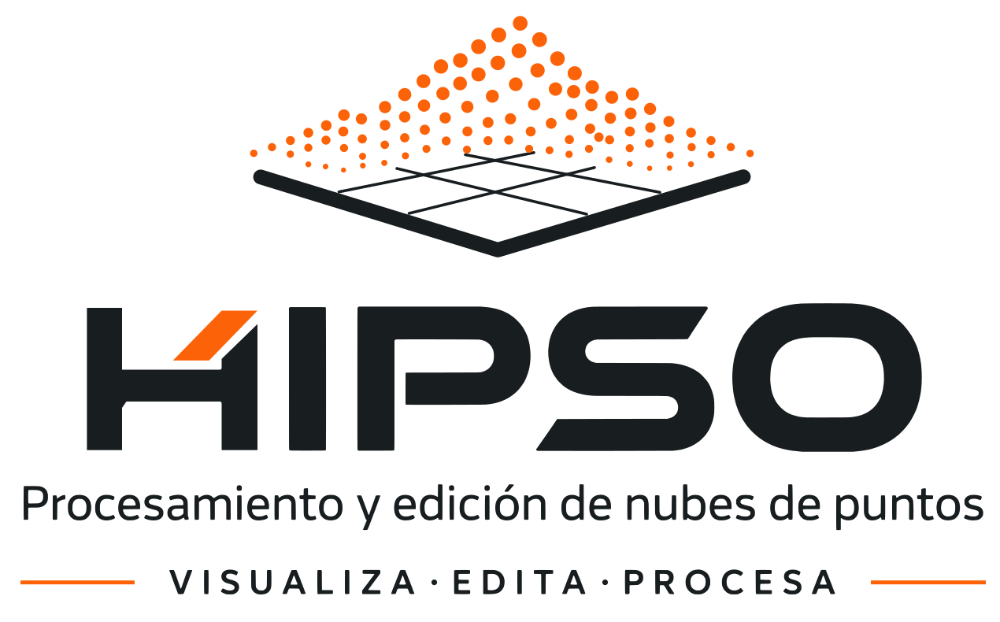
  </picture>
</p>

<p align="center">
  Rápido, ligero con nubes enormes y cómodo de editar. Windows, macOS y Linux.
</p>

<p align="center">
  <a href="https://github.com/juliomsevilla/HIPSO/releases/latest"></a>
  
  
</p>

---

## Descargar

En la página de **[Releases](https://github.com/juliomsevilla/HIPSO/releases/latest)** se descarga el paquete del sistema (Windows, macOS Apple Silicon o Intel, Linux), se descomprime y se ejecuta `hipso-gui` (en macOS, `HIPSO.app`). No necesita instalador ni permisos de administrador.

**La primera vez que se abre**

- **Windows:** si aparece el aviso azul de SmartScreen, se elige *Más información → Ejecutar de todas formas*.
- **macOS:** `HIPSO.app` se abre sin ventana de Terminal. El programa no está firmado por un desarrollador que Apple conozca, de modo que la primera vez macOS lo bloquea: se abre una vez, se va a *Ajustes del Sistema → Privacidad y seguridad* y se pulsa *Abrir igualmente*. Si el paquete se descarga con el navegador, macOS marca también `hipso` y `hipso-gui` y los cierra al ejecutarlos desde la consola; se desbloquean con `xattr -dr com.apple.quarantine HIPSO-macos-arm64` (o `-x64`) sobre la carpeta descomprimida, y si aun así no arrancan, con `chmod +x hipso-gui hipso`.
- **Linux:** si el archivo perdió el permiso, se recupera con `chmod +x hipso-gui hipso`. Hacen falta GTK 3 para los diálogos de archivo y OpenGL 2 o superior (Mesa sirve).

---

## Qué hace

### Premisas

HIPSO persigue tres cosas por este orden:

1. **Rapidez**: cualquier nueva implementación se testea para ver si mejora frente a otros desarrollos y softwares libres.
2. **Eficiencia con nubes de puntos enormes**: los procesos leen la nube como un flujo, la memoria depende del área y de la celda (no del número de puntos) y los pasos locales trabajan por teselas en paralelo.
3. **Edición cómoda y asequible**: Seleccionar, reclasificar y borrar exige pocos clics, se puede deshacer y rehacer, y el resultado se ve al instante en planta, perfil y 3D.

Y, además... creemos que un software que aúne estas tres premisas debe estar disponible para cualquier técnico de este ámbito **sin tener que pagar licencias desorbitadas**.

### Visor y edición

- Ventanas **2D**, **2D + perfil**, **3D** y **2D + perfil + 3D**.
- **Rásteres en 3D**: un MDT, un CHM o cualquier ráster de una banda se ve como superficie en la vista 3D, con los colores de su simbología y la exageración vertical a mano, y se combina con la nube de puntos. El perfil dibuja además la línea de los rásteres visibles junto a los puntos, con su cuadrícula de cotas. Se dibuja en el procesador, sin tarjeta gráfica: unos 9 ms por imagen con una malla de 4 millones de celdas.
- **Cinta de opciones** con seis pestañas (*Archivo*, *Vista*, *LiDAR*, *Vectorial*, *Raster* y *Flujos*) que se pliegan en menús al estrechar la ventana. Cada geoproceso vectorial y cada operación ráster abre su propia ventana.
- **Selección múltiple de capas** en el panel *Contenido* (Ctrl o Cmd y clic, Mayús y clic): se muestran, ocultan, suben, bajan, amplían y quitan de una vez.
- Navegación 3D libre: giro sin tope, desplazamiento en el plano de la pantalla, zoom con la rueda, encuadre con doble clic.
- Colorear por elevación, clase, intensidad, retorno, pasada, archivo, RGB o ID de árbol.
- **Edición por selecciones** (rectángulo, círculo, polígono, lazo, en planta, en perfil o **en la vista 3D**, con rebanada de profundidad y *Aislar selección* para editar un árbol a toda su densidad) con filtros por clase, altura, intensidad y retorno; eliminar o reclasificar; deshacer, rehacer e historial. El original nunca se modifica.
- **Histogramas de atributos** (elevación, intensidad, retornos, clase, pasada, ángulo de barrido): se marcan barras para seleccionar los puntos, o se detectan los valores raros con un estadístico (Tukey, MAD, desviaciones típicas, percentiles).
- **Proyectos (`.hipso`):** guardan qué nubes y capas están abiertas, su orden, visibilidad, la vista y la orientación 3D, para retomar la sesión donde se dejó.
- **Capas grandes sin colgarse:** las capas vectoriales pesadas se dibujan como una imagen (un shapefile de 41 mil objetos pasa de 4,5 GB a 233 MB) y se consultan con un índice espacial R-tree. Cualquier nube LAS/LAZ se lee a más detalle, en segundo plano, al acercar el zoom en planta y en 3D (con una copia COPC en la caché que se crea sola), con relleno de huecos; reabrir una nube grande tarda menos de un segundo y el perfil lee todos los puntos de su franja.
- **Clases ASPRS 0–255:** la tabla vigente y clases nuevas propias (64–255) con nombre y color.

### LiDAR

| Grupo | Herramientas |
|---|---|
| **Preparar** | **Clasificar** (véase *Clasificación de puntos*): solape entre pasadas, ruido, suelo con seis métodos, edificios, vegetación por estratos, cables, postes y torres, carreteras, agua y reglas, todo guardable en una receta · Asignar proyección · Exportar puntos (LAZ, LAS, texto, shapefile, COPC) · **Recortar con polígonos** (una nube por polígono o una ajustada al perímetro, con búfer) · Adelgazar nube (densidad objetivo, celdas, percentil, 3D, uno de cada n) · Alturas sobre el suelo (atributo o nube normalizada) · Quitar duplicados · **Colorear con una imagen (RGB)** · **Normalizar la intensidad por distancia** · **Imagen de intensidad** (GeoTIFF en tonos de gris con una escala común para todas las hojas, y mosaico opcional) · **Exportar a COPC** |
| **Calidad** | Comparar nubes (cambios) · Ajustar una nube a otra (ICP) · Separación entre pasadas (por ID de fuente, por nube o por los huecos del tiempo GPS) · **Líneas de vuelo** de una nube aérea por los huecos del tiempo GPS, con tabla, contornos y copias con el número de línea · **Densidad de Voronoi**, que mide la densidad con las celdas de Voronoi de los puntos, deja aparte los huecos de datos y da el porcentaje que llega a un umbral |
| **Superficies** | MDT (triangulación por defecto, ponderado por distancia o media por celda, con **líneas de rotura**) · MDS / CHM (MDS por triangulación, ponderado por distancia o máximo por celda; CHM sin depresiones de copa (*pit-free*) y con suavizado) |
| **Análisis del terreno** (pestaña *Raster*) | Una ventana por producto: pendiente, orientación y sombreado (*Relieve*); curvaturas, rugosidad, TRI, TPI y **Crestas y drenaje**, con orden de Strahler (*Forma del terreno*); depresiones, acumulación de flujo, TWI, red de drenaje, subcuencas, **Zonas encharcadas** e **Inundación** a uno o varios niveles (*Hidrología*); cuenca visual y **Ruta de menor coste** por pendiente, tiempo de marcha o ráster de costes (*Visibilidad y rutas*); y volumen sobre (y bajo) el MDT, **Cubicación de pilas** y **Desmonte y terraplén** (*Volúmenes*). Los bordes y los huecos sin dato quedan vacíos por defecto (como `gdaldem`) o se rellenan a elección |
| **Inventario de la vegetación** | Métricas por celda · Extraer muestras (de archivo, muestreo o dibujadas; con zona de influencia o búfer y partición de multipartes por la línea de comandos) · Segmentar individuos (Dalponte, Silva, cuencas, ventana variable) con evaluación frente a campo, GeoPackage con ápices y copas y las métricas de la nube en cada copa · **Medición de troncos**: mide diámetros a lo largo del tronco, estima el volumen con Smalian, estima la altura libre de ramas de los troncos perdidos y guarda la nube con **troncos (clase 64) y ramas (clase 65)** para editarla · **Modelos lineales**: regresión de volumen, área basimétrica… sobre las métricas LiDAR, validada dejando una unidad de muestreo fuera cada vez, y su mapa · Cambio de la cubierta vegetal · Análisis por objetos (OBIA) |
| **Infraestructuras** | **Corredores eléctricos**: mide la vegetación que invade o puede caer sobre una línea ya clasificada (cables y postes), con informe por vano |

### Clasificación de puntos

**Clasificar** es una cadena de pasos independientes que se activan por separado y se ejecutan por teselas en paralelo, con la misma herramienta en la ventana y en la línea de comandos:

- **Pasos:** solape entre pasadas (clase 12), ruido, suelo (Kraus y Pfeifer, MCC, CSF, PMF, SMRF y Axelsson), edificios, vegetación por estratos, cables, postes y torres, carreteras y agua. Al final, reglas por clase, altura sobre el suelo, intensidad, eco, ángulo de barrido y forma del entorno (pendiente, planaridad, linealidad), que completan o corrigen lo anterior.
- **Versátil con el sensor:** sirve para hojas aéreas de unos 10 puntos/m² (PNOA), para vuelos de dron de cientos de puntos/m² y para tiras sobre líneas eléctricas. Lo que depende de la densidad o de la escala del sensor se ajusta solo: el radio con el que se buscan los cables, los puntos que puede tener una torre, el límite de intensidad de carreteras y agua (relativo al suelo de cada tesela) y el solape, que no aparta nada en un vuelo con pasadas repetidas. No se ha probado con escáneres móviles ni terrestres.
- **Recetas:** toda la clasificación (pasos, parámetros y reglas) cabe en un archivo de texto. Se guarda y se carga desde la ventana (*Guardar receta…*, *Cargar receta…*) o con `hipso classify --recipe receta.txt`, se aplica igual a una hoja o a un bloque entero y deja escrito cómo se clasificó. Hay dos de ejemplo en [`docs/recetas`](docs/recetas): una para obtener una clasificación similar a la del NPC03 del PNOA y otra para líneas eléctricas en vuelos densos.
- **Constructor de flujos:** la pestaña *Flujos* dibuja un inventario como un grafo de nodos (cada herramienta de `hipso` es un nodo, cada archivo un hilo), con paleta, lienzo, opciones de cada nodo y problemas en vivo. Se ejecuta en segundo plano con estado por nodo, borra los intermedios y deshace todo si un paso falla, y se guarda como `.model.json` que `hipso run` ejecuta sin interfaz sobre otra zona.
- **Ajustes de la caché:** *Inicio → Ajustes* muestra la carpeta de la caché de detalle, deja elegir otra y el tamaño máximo en gigabytes, y *Borrar caché…* la vacía tras explicar lo que implica.
- **Qué está medido:** el suelo con las pruebas de la ISPRS y de OpenGF, y los edificios, los cables y los postes con las nubes etiquetadas a mano de DALES. Con las hojas NPC03 la receta de ejemplo coincide en el 94-95 % de los puntos, pero esa clasificación es la del proveedor y no una verdad del terreno. Los cables y los postes se encuentran peor con densidad media (9 puntos/m²) y mejor en vuelos densos, y conviene revisarlos a mano antes de darlos por buenos. Los resultados completos, con sus límites, están en el manual.

### Ráster

Las imágenes multibanda admiten **composiciones de bandas** y **índices espectrales** (NDVI, GNDVI, NDWI, EVI, SAVI, NDMI, NBR, VARI, ExG o una expresión propia).

**Reproyectar**, **igualar la extensión** y **remuestrear** son una sola operación sobre los rásteres, y se hace respecto a un código EPSG, al sistema de otro ráster o a las celdas de otro ráster de referencia (su sistema, su extensión, su origen y su celda), de modo que el resultado coincide con él celda a celda. El remuestreo es vecino más cercano, bilineal, cúbico, media o moda, o automático según los datos (las clases conservan sus valores), y la ayuda de cada ventana dice cuándo conviene cada uno. *Mosaico*, *Crear multibanda* y la *Calculadora* reproyectan por sí mismos los rásteres que están en otro sistema de coordenadas. La velocidad es la razón de fondo de que sea una sola pasada por franjas: en un modelo de elevaciones de 114 millones de celdas tarda 2,5 veces menos que GDAL (véase *Rendimiento*).

La reproyección de **nubes y rásteres** admite además el **cambio de la referencia vertical** (de alturas elipsoidales a ortométricas con el geoide, o a la inversa), y es estricta. Si la transformación no puede hacerse con la mejor operación (falta una rejilla, el punto cae fuera de la cobertura del geoide, no hay ajuste de datum) se detiene con un error y no entrega un valor aproximado en silencio, salvo que se acepten las aproximaciones. Las alturas de cada archivo se leen de su propia referencia vertical y, si no la declara, se pide en lugar de suponerla.

**Reclasificar** cambia los valores de un ráster con una tabla de reglas (un valor, un intervalo o una comparación pasan a un valor nuevo o a «sin datos»), y **Cortar por máscara** deja vacío lo que queda fuera de una capa de polígonos o de otro ráster, con o sin recorte a la caja de la máscara. Ambos trabajan por franjas.

*Crear multibanda* une rásteres sueltos en uno solo, y *Mosaico* resuelve los solapes con la regla que se elija: primero, último, media, mínimo, máximo, mediana, suma o número de capas. La **calculadora ráster** evalúa una expresión (con operaciones, comparaciones, funciones y condiciones) celda a celda sobre varios rásteres con nombre, por franjas, de modo que la memoria no depende del tamaño del ráster. *Vectorizar* convierte un ráster en polígonos por clase, rango o intervalos, con el valor, el área y el número de celdas como atributos, en shapefile o GeoPackage.

*Tamizar* (quitar manchas pequeñas de un ráster de clases), *proximidad* (distancia exacta a unas clases) y *relleno de huecos* por distancia inversa tienen cada uno su ventana en la pestaña *Raster* y su orden en la línea de comandos.

Los mosaicos, las imágenes multibanda y los rásteres igualados se escriben como **Cloud Optimized GeoTIFF** multibanda, en teselas con vistas reducidas, con JPEG para las ortofotos o sin pérdida (tres hojas de ortofoto PNOA ocupan 2,4 GB en vez de 14,7). Como la lectura es por ventana y la escritura por franjas comprimidas, se unen imágenes de varios gigabytes con poca memoria.

### Vectorial

Cada campo de una capa tiene un **tipo** (texto, entero, decimal, sí/no, fecha o hipervínculo), que se elige al crear la capa o el campo. La tabla comprueba lo que se escribe, abre los enlaces con un clic y permite cambiar el tipo de un campo, los tipos se conservan en shapefile, GeoPackage y GeoJSON, y las consultas y la calculadora de campos leen cada campo según su tipo (las fechas con `date()`, `today()` o `year()`, los sí/no como verdadero o falso y el texto como texto).

La **estadística zonal** calcula, para cada polígono, el recuento, el mínimo, el máximo, la media, la suma, la desviación típica y la mediana de las celdas de un ráster (por ejemplo, el CHM medio de cada rodal). El resultado es una capa de polígonos que conserva los campos originales y añade uno por estadístico. **Voronoi** genera una capa de polígonos con la celda de Voronoi de cada punto y, si se pide, las aristas de Delaunay.

Las herramientas de **capas y tablas** (pestaña *Vectorial*, grupo *Capas y tablas*) extraen los valores de un ráster a una capa, unen una tabla por un campo, combinan y dividen capas, recortan o borran con polígonos (también puntos y líneas), miden la distancia al elemento más cercano y resumen campos por grupos; en la pestaña *Raster*, el grupo *Geoprocesos* rasteriza capas, aplica filtros focales, calcula estadísticas e histogramas y tabula áreas por zona. Todas son órdenes de `hipso`, abren una ventana generada a partir de la orden y son nodos del constructor de flujos. La edición vectorial suma ajuste a bordes, transformar la selección, reformar polígonos con un trazo, copiar y pegar entre capas y la comprobación de topología (solapes, huecos, autointersecciones y cabos sueltos).

Los **geoprocesos con polígonos** son comprobar y reparar la validez, el búfer (ampliar o reducir, también sobre puntos), disolver por un campo y la unión de dos capas, siempre con la tabla de atributos conservada. Las operaciones que pueden dar resultados engañosos con geometrías rotas (búfer, disolver, unión) se niegan a trabajar con ellas y piden repararlas antes. La digitalización, la tabla de atributos editable y la simbología se describen en *Capas y formatos*.

### Capas y formatos

LAS y LAZ (también **COPC**, leído solo en la parte que hace falta y escrito con *Exportar puntos*), **PLY** y **E57** (se convierten a LAZ), ASCII, shapefile, **GeoJSON**, **KML/KMZ**, **GeoPackage** (lectura de varias tablas, cada una reproyectada desde su sistema, y **escritura** con índice R-tree, con escritor propio en Rust puro validado con SQLite y GDAL) y CSV. Rásteres: GeoTIFF (y **Cloud Optimized GeoTIFF**), **JPEG 2000** (las bandas de **Sentinel-2**, con lector propio en Rust que solo decodifica las teselas que se piden), PNG y JPEG con archivo de coordenadas, ENVI y SRTM `.hgt`. ECW y MrSID no se leen (ECW es propietario: se convierte antes con QGIS, GeoLibre o RustGis). Capas vectoriales con digitalización, tabla de atributos editable y simbología. **Mapa base** que se enciende y apaga desde el explorador de capas (OpenStreetMap, ortofoto PNOA, o un servidor propio de teselas).

<table>
  <tr>
    <td width="50%">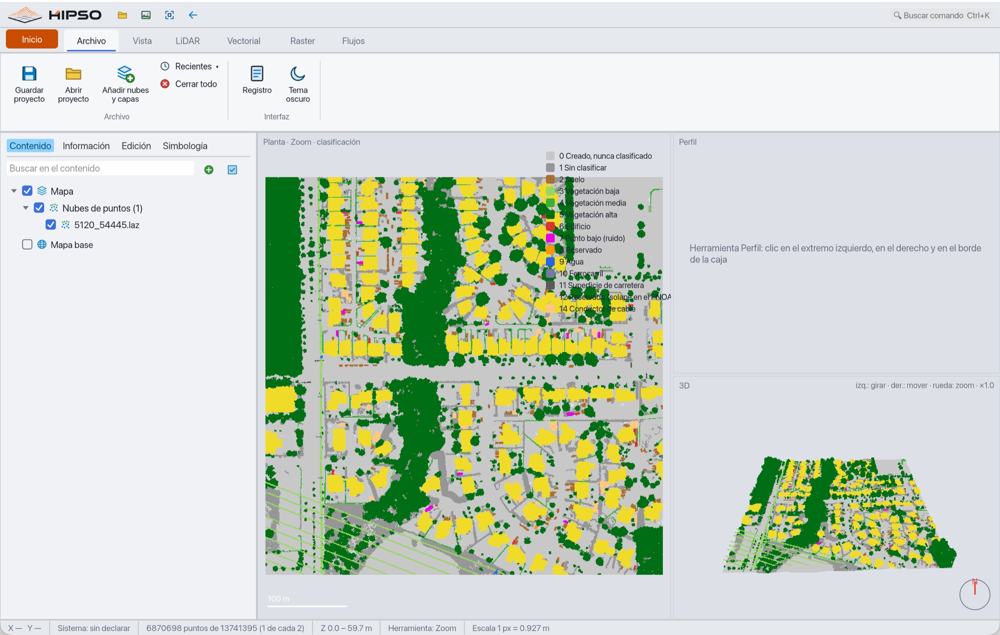</td>
    <td width="50%">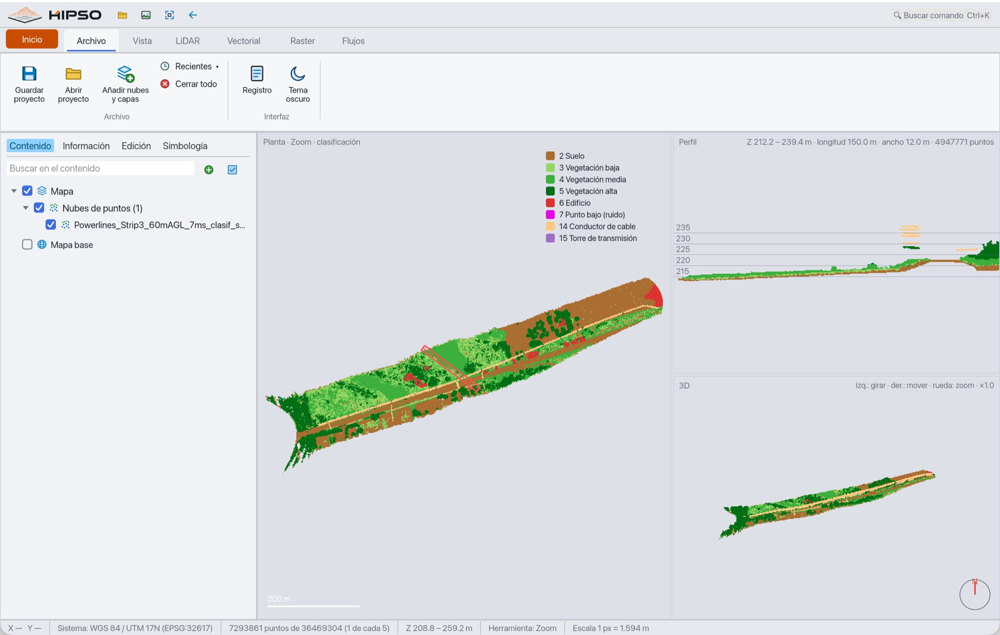</td>
  </tr>
  <tr>
    <td width="50%">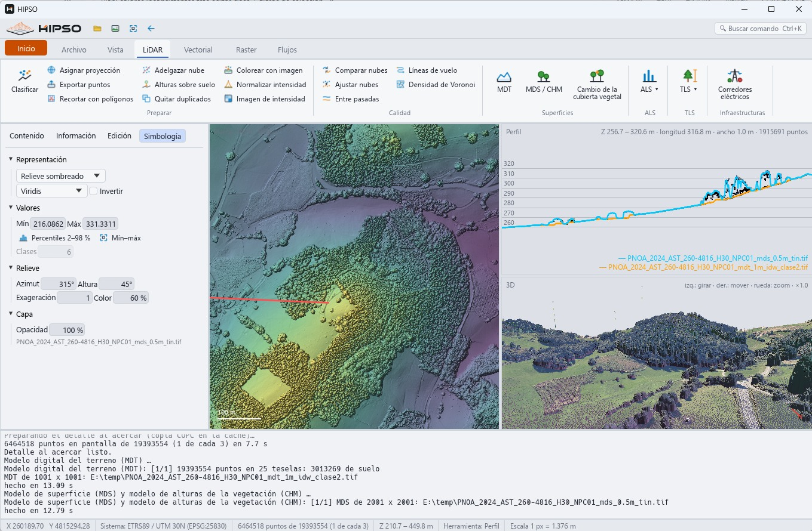</td>
    <td width="50%">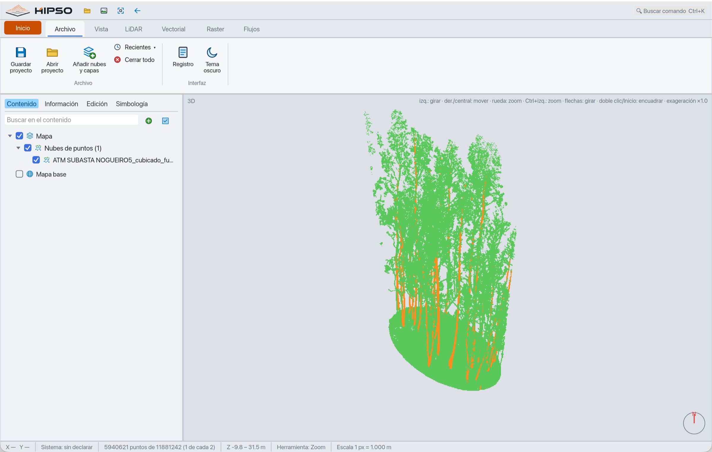</td>
  </tr>
  <tr>
    <td width="50%">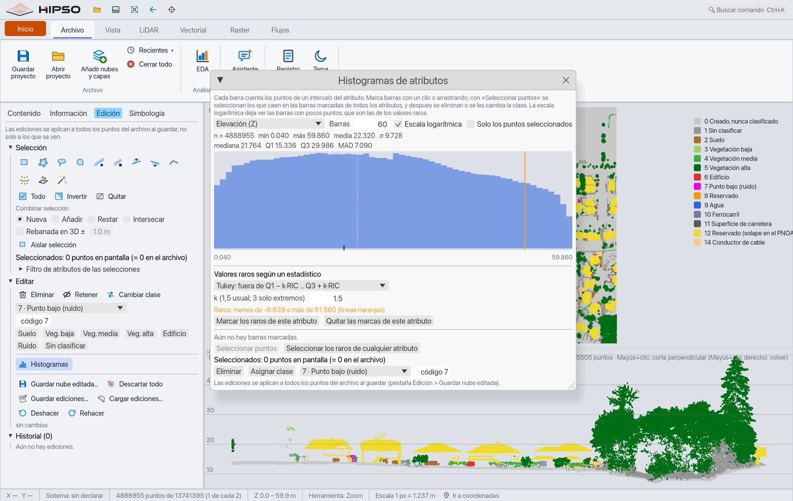</td>
    <td width="50%">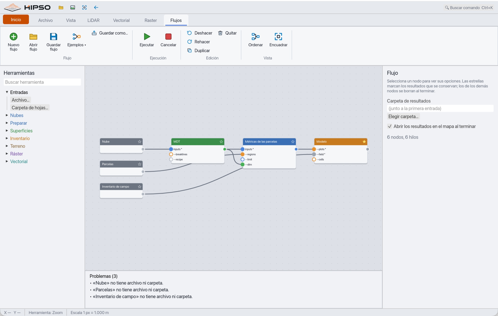</td>
  </tr>
  <tr>
    <td width="50%">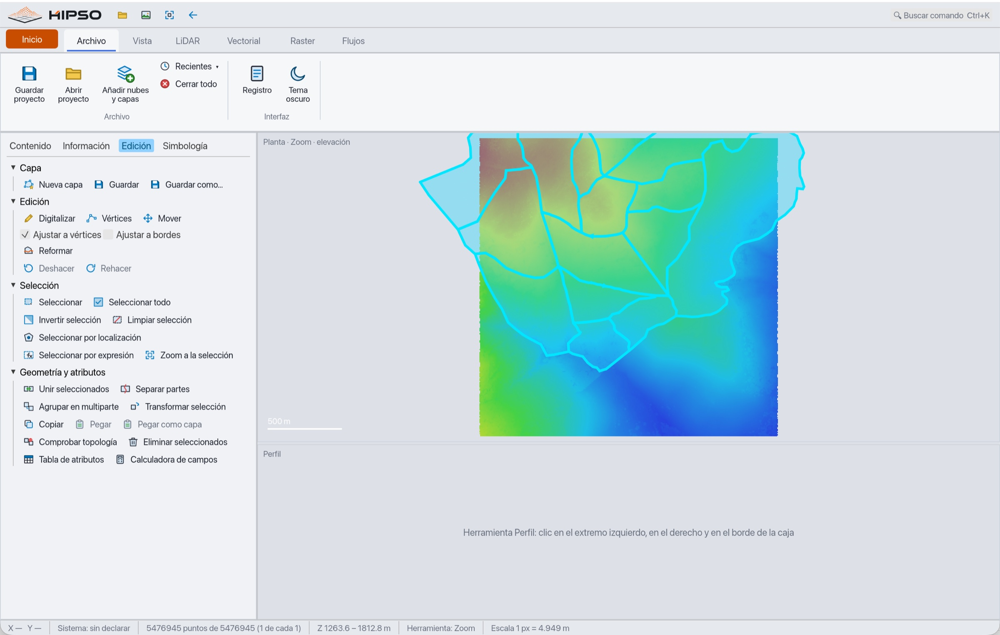</td>
    <td width="50%">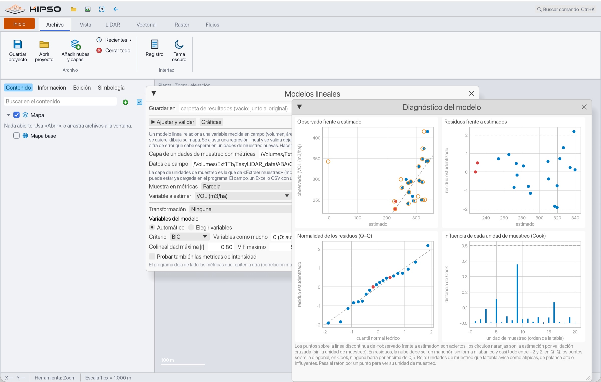</td>
  </tr>
  <tr>
    <td width="50%">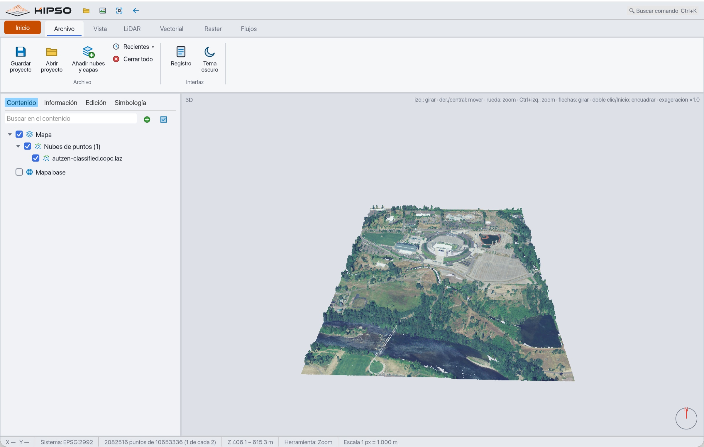</td>
    <td width="50%">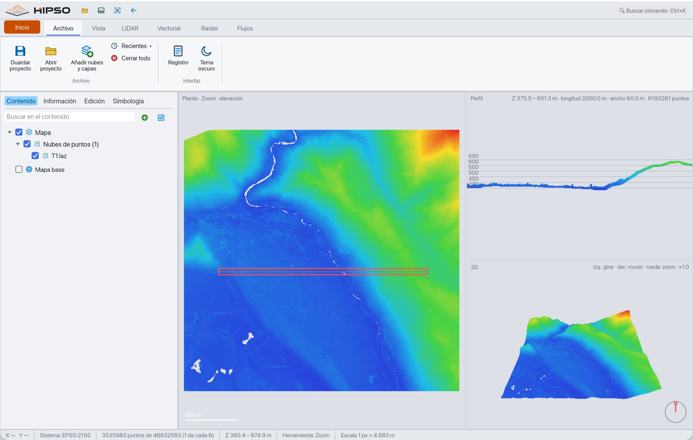</td>
  </tr>
</table>

<sub>Datos del PNOA LiDAR (© Instituto Geográfico Nacional, CC BY 4.0), DALES, OpenGF, el estadio de Autzen y datos propios de campo y de escáner terrestre.</sub>

---

## Manual

El manual completo está en [`la web del programa`](https://juliomsevilla.github.io/HIPSO/) y dentro del software: **Inicio → Manual** o la tecla **F1**. La referencia de la línea de comandos está en el apartado de  [`Referencia de la línea de comandos`](https://juliomsevilla.github.io/HIPSO/referencia.html) de la web.

## Línea de comandos

`hipso` hace lo mismo que la interfaz, por lotes:

```sh
hipso info nube.laz
hipso thin nube.laz --method density --density 1
hipso classify nube.laz --ground csf --noise isolated --buildings --vegetation
hipso dtm nube.laz --cell 1
hipso chm nube.laz --cell 0.5 --method pitfree
hipso stem-volume muestra_tls.laz --csv --tree-clouds --stem-classes
hipso mosaic a.tif b.tif -o mosaico.tif --overlap mean
hipso colorize nube.laz --image ortofoto.tif
hipso copc nube.laz
hipso import escaneo.e57 --epsg 25830
hipso reproject nube_ed50.laz -o nube_etrs89.laz --to 25830
hipso reproject nube.laz --to 25830 --vertical-in ellipsoidal --vertical-out 5782 -o nube_orto.laz
hipso reproject mdt.tif -o mdt_celdas_chm.tif --reference chm.tif --resample bilinear
hipso reclass mdt.tif --rules "<500 = 1; 500..1000 = 2; >1000 = 3"
hipso clip-raster mdt.tif --mask rodales.shp
hipso zonal chm.tif --regions rodales.shp --prefix chm_
hipso buffer rodales.shp --distance 25
hipso dissolve rodales.shp --field especie
hipso sieve clases.tif --threshold 5
hipso compare nube2.laz --reference nube1.laz --distance 0.5
```

`hipso <comando> --help` lista todos los parámetros.

## Limitaciones conocidas

**Coordenadas.** Cuando una herramienta combina archivos en sistemas distintos, HIPSO los transforma al sistema de la primera nube y lo dice en el informe. Las transformaciones coinciden con las de PROJ, y las mallas oficiales de España (ED50 a ETRS89 y el geoide EGM08-REDNAP) van dentro del programa.

- Las alturas solo cambian si se pide (ventana *Reproyectar* o `hipso reproject --vertical-in … --vertical-out …`), y si el archivo no declara su referencia vertical, se pregunta.
- Una transformación aproximada (sin ajuste de datum, sin geoide para el punto, con una rejilla que falta) se rechaza con un error; se acepta con `--allow-ballpark` y `--allow-fallback`.
- Fuera de España los geoides y las mallas de datum se buscan en `HIPSO_GRID_DIR`, `PROJ_DATA` o `PROJ_LIB`, o se descargan con `HIPSO_NETWORK=ON`.
- Los rásteres que se combinan (*Apilar*, *Mosaico*, *Igualar rásteres*, *Calculadora*) se reproyectan al sistema de la referencia o del primero, siempre que ambos lo declaren, y las nubes no se pasan desde o hacia grados.

## Rendimiento

Banco de pruebas: **598 teselas del PNOA** (6.865 millones de puntos, 41 GB de LAZ) en dos husos UTM, solapadas entre sí, en un Mac con M4 de 10 núcleos y 16 GB de memoria.

**De las teselas a los productos**, una orden por producto:

| Tarea | Tiempo | Memoria máxima |
|---|---|---|
| MDT 1 m de las 598 teselas y mosaico (622 millones de celdas, con las de otro huso pasadas al vuelo) | 23 min | 2,7 GB |
| CHM 1 m y mosaico | 22 min | 0,9 GB |
| Métricas por celda de 15 m | 16 min | 0,95 GB |

La memoria no crece con el número de teselas: cada una se procesa por separado, y si alguna está dañada se salta, se nombra y el resto sigue.

**Sobre ese mosaico de 622 millones de celdas, frente a terra** (R, 1.9.11, mismo equipo y mismo disco):

| Operación | terra | HIPSO | Memoria de HIPSO |
|---|---|---|---|
| Pendiente | 26,6 s | **13,9 s** | 1,3 GB |
| Sombreado | 86,2 s | **11,5 s** | 1,3 GB |
| Reproyección entre husos | 137,7 s | **40,1 s** | 2,0 GB |

**Reproyectar un ráster de 10.694 x 10.694 celdas** (114 millones, de UTM 30N a 29N, con remuestreo bilineal) se ha comparado con GDAL 3.9, el motor de `gdalwarp`, usado desde Python con `rasterio`, con todos los núcleos y en el mismo equipo. GDAL trabaja en memoria y escribe después con el controlador COG (teselas de 512, deflate y vistas reducidas), que da el mismo producto que HIPSO.

| Ráster | GDAL 3.9 | HIPSO | |
|---|---|---|---|
| Modelo de elevaciones, 1 banda decimal | 4,9 s | **2,0 s** | 2,5 veces menos tiempo |
| Ortofoto, 3 bandas de 8 bits | **2,1 s** | 2,5 s | GDAL es algo más rápido |

La ventaja depende, por tanto, del tipo de ráster. Con un modelo de elevaciones HIPSO es claramente más rápido, pero con una ortofoto de tres bandas de 8 bits la ventaja desaparece, y es GDAL el que termina antes.

Los valores coinciden con los de GDAL. En el modelo, la diferencia máxima es de 0,05 m sobre un relieve de 70 m (bilineal y cúbico), y las celdas del borde que solo uno de los dos rellena son el 0,02 %. Además, HIPSO trabaja por franjas y su memoria no depende del tamaño del ráster, mientras que GDAL necesitó el ráster entero en memoria.

Los rásteres grandes se trabajan **por franjas con margen**: la memoria depende de la franja y no del tamaño del ráster, y el resultado es idéntico, celda a celda, al de leerlo entero. El tamaño de la franja se ajusta a la memoria del equipo, así que en una máquina de 64 GB el mismo programa trabaja con franjas cuatro veces mayores.

## Licencia

HIPSO es un programa gratuito de licencia propietaria: de **uso gratuito**, también para trabajo profesional y comercial. No se puede modificar, desmontar, descompilar ni someter a ingeniería inversa, ni vender ni redistribuir salvo en su paquete original y gratis. Las condiciones están en [`LICENSE`](LICENSE). Los componentes de terceros conservan sus licencias ([`NOTICE`](NOTICE), [`THIRD_PARTY_LICENSES.md`](THIRD_PARTY_LICENSES.md), [`licenses/`](licenses)).

## Autoría y contacto

Se agradecen las sugerencias y los fallos comunicados en [Issues](https://github.com/juliomsevilla/HIPSO/issues). La licencia no permite modificar ni redistribuir el programa. Los errores se irán corrigiendo en la medida de lo posible.

## Aviso

HIPSO está construido en algunas partes con [Claude](https://www.anthropic.com/claude), un modelo de IA de Anthropic, bajo dirección y revisión humanas. Sus resultados se contrastan con otros programas libres como FUSION, lidR y GeoLibre, pero conviene comprobarlos antes de usarlos y avisar de cualquier cosa que parezca incorrecta.
