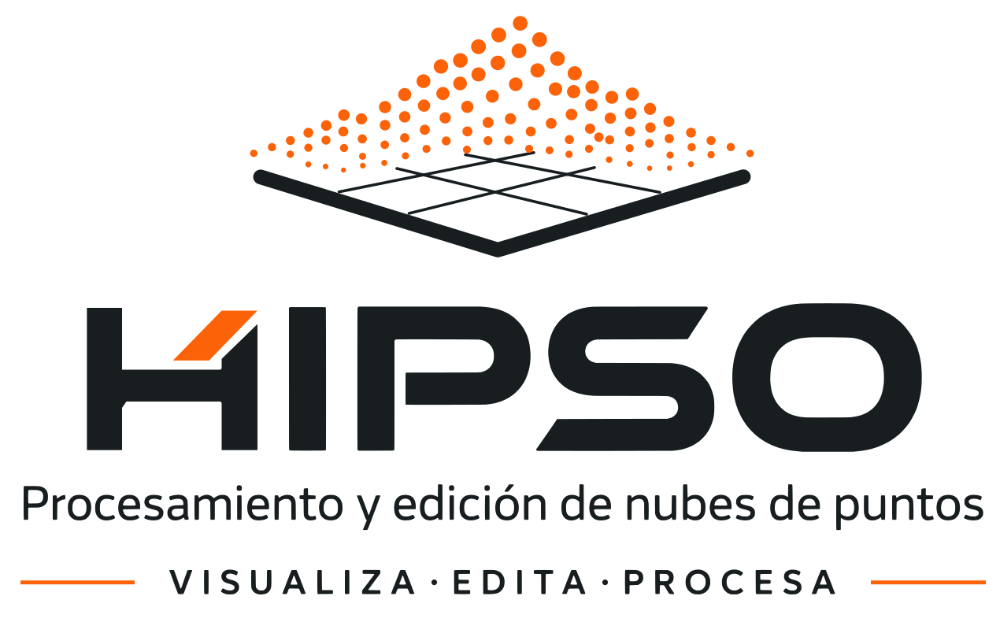
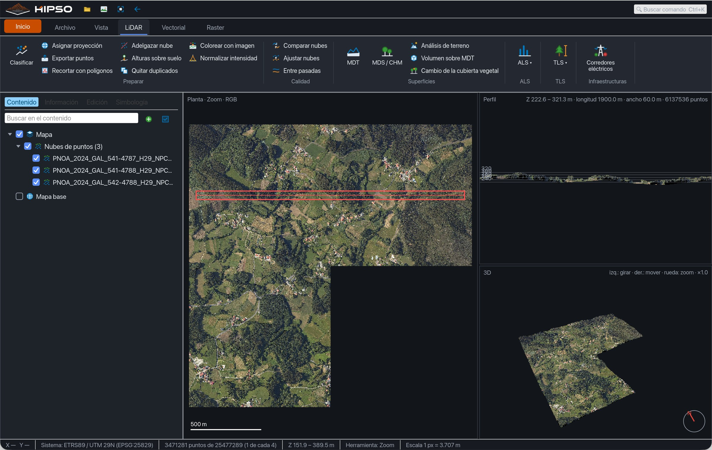
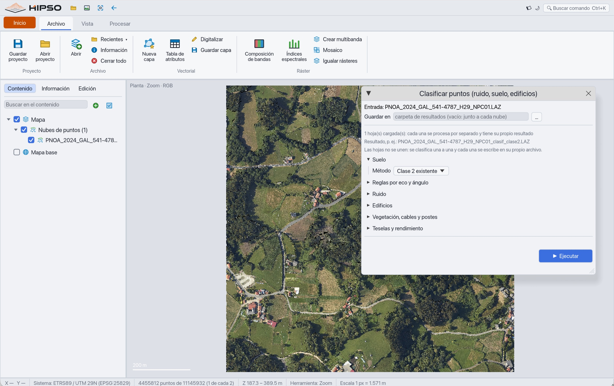
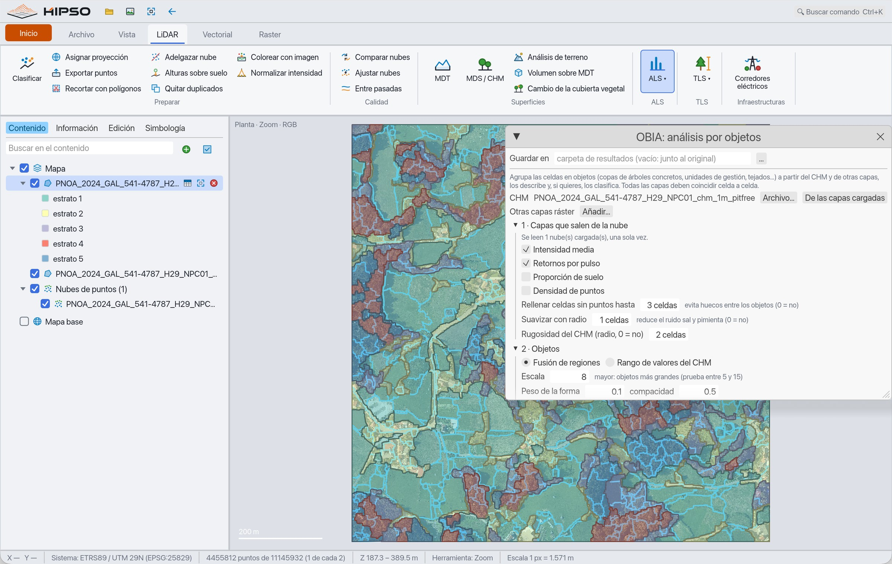
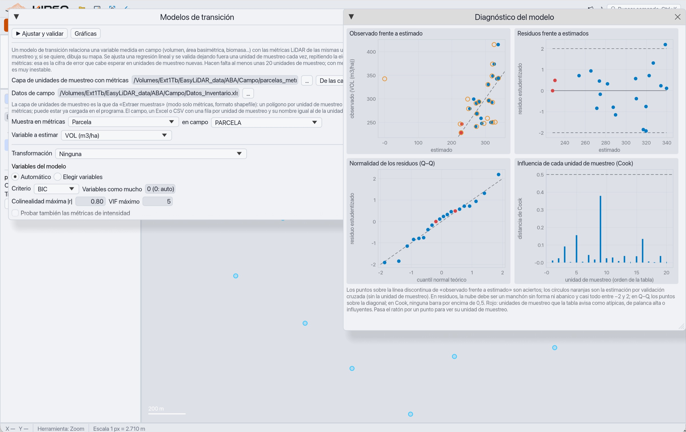
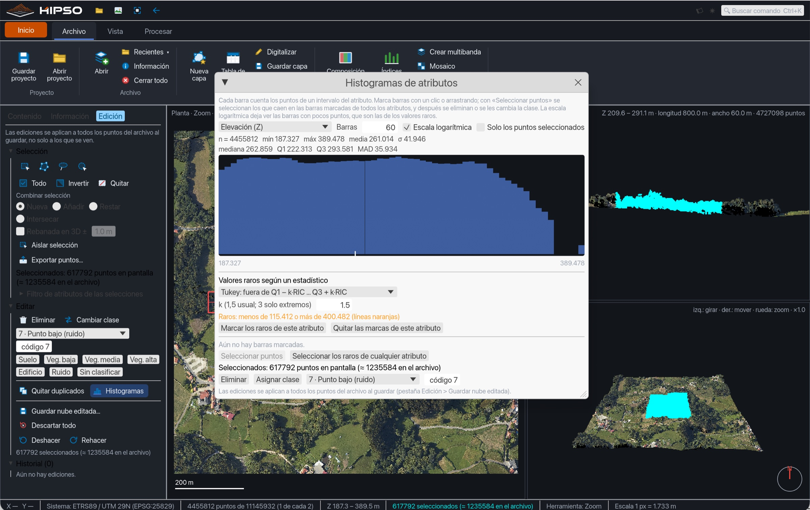
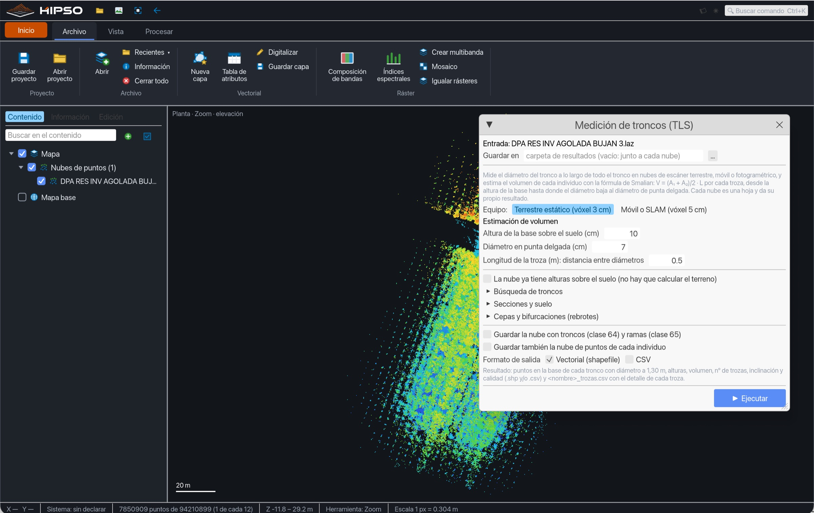
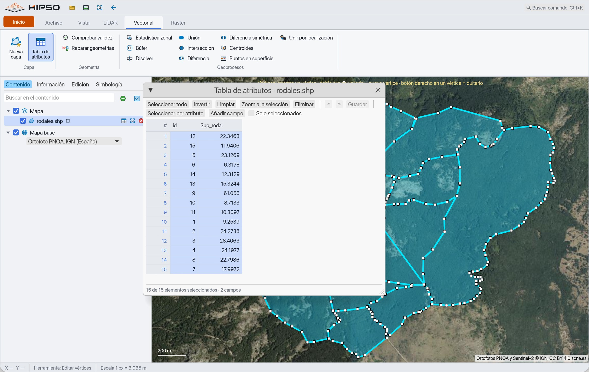
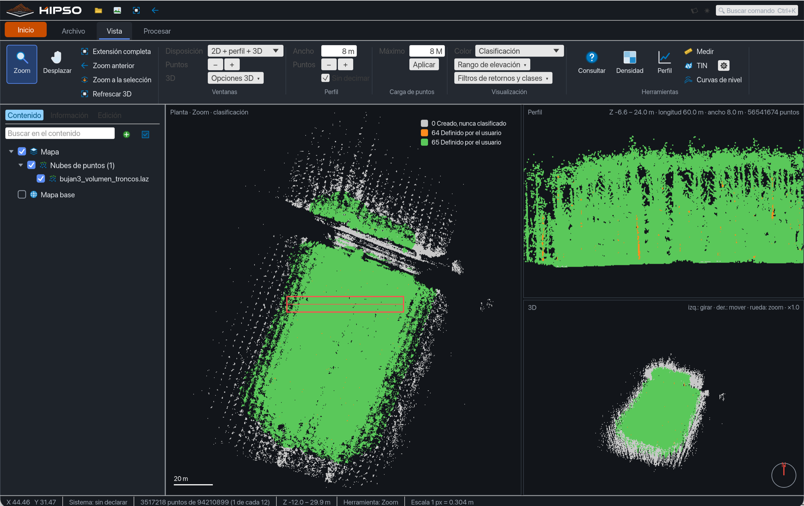

<p align="center">
  <picture>
    <source media="(prefers-color-scheme: dark)" srcset="assets/brand/hipso-logo-completo-blanco.svg">
    
  </picture>
</p>

<p align="center">
  Rápido, ligero con nubes enormes y cómodo de editar. Windows, macOS y Linux.
</p>

<p align="center">
  <a href="https://github.com/juliomsevilla/HIPSO/releases/latest"></a>
  
  
</p>

---

## Descargar

Ve a la página de **[Releases](https://github.com/juliomsevilla/HIPSO/releases/latest)**, descarga el paquete de tu sistema (Windows, macOS Apple Silicon o Intel, Linux), descomprímelo y ejecuta `hipso-gui` (en macOS, `HIPSO.app`). No necesita instalador ni permisos de administrador.

**Primera vez que lo abres**

- **Windows:** si aparece el aviso azul de SmartScreen: *Más información → Ejecutar de todas formas*.
- **macOS:** abre `HIPSO.app` (no abre ventana de Terminal). El programa no está firmado por un desarrollador que Apple conozca, así que la primera vez macOS lo bloquea: ábrelo una vez, ve a *Ajustes del Sistema → Privacidad y seguridad* y pulsa *Abrir igualmente*. Si descargas el paquete con el navegador, macOS marca también `hipso` y `hipso-gui` y los cierra al ejecutarlos desde la consola; se desbloquean con `xattr -dr com.apple.quarantine HIPSO-macos-arm64` (o `-x64`) sobre la carpeta descomprimida, y si no arrancan: `chmod +x hipso-gui hipso`.
- **Linux:** `chmod +x hipso-gui hipso` si el archivo perdió el permiso. Hace falta GTK 3 para los diálogos de archivo y OpenGL 2 o superior (Mesa sirve).

---

## Qué hace

### Premisas

1. **Rapidez.**
2. **Eficiencia con nubes de puntos enormes:** los procesos leen la nube como un flujo y la memoria depende del área y de la celda, no del número de puntos. Los pasos locales trabajan por teselas en paralelo.
3. **Edición cómoda de nubes de puntos:** seleccionar, reclasificar y borrar con pocos clics, deshacer y rehacer, y ver el resultado al instante en planta, perfil y 3D.

### Visor y edición

- Ventanas **2D**, **2D + perfil**, **3D** y **2D + perfil + 3D**.
- Navegación 3D libre: giro sin tope, desplazamiento en el plano de la pantalla, zoom con la rueda, encuadre con doble clic.
- Colorear por elevación, clase, intensidad, retorno, pasada, archivo o RGB.
- **Edición por selecciones** (rectángulo, círculo, polígono, lazo, en planta, en perfil o **en la vista 3D**, con rebanada de profundidad y *Aislar selección* para editar un árbol a toda su densidad) con filtros por clase, altura, intensidad y retorno; eliminar o reclasificar; deshacer, rehacer e historial. El original nunca se modifica.
- **Histogramas de atributos** (elevación, intensidad, retornos, clase, pasada, ángulo de barrido): se marcan barras para seleccionar los puntos, o se detectan los valores raros con un estadístico (Tukey, MAD, desviaciones típicas, percentiles).
- **Proyectos (`.hipso`):** guardan qué nubes y capas están abiertas, su orden, visibilidad, la vista y la orientación 3D, para retomar la sesión donde la dejaste.
- **Capas grandes sin colgarse:** las capas vectoriales pesadas se dibujan como una imagen (un shapefile de 41 mil objetos pasa de 4,5 GB a 233 MB) y se consultan con un índice espacial R-tree. Cualquier nube LAS/LAZ se lee a más detalle, en segundo plano, al acercar el zoom en planta y en 3D (con una copia COPC en la caché que se crea sola), con relleno de huecos y relieve opcional; reabrir una nube grande tarda menos de un segundo y el perfil lee todos los puntos de su franja.
- **Clases ASPRS 0–255:** la tabla vigente y clases nuevas propias (64–255) con nombre y color.

### Procesar

| Grupo | Herramientas |
|---|---|
| **Preparar** | **Clasificar**: ruido (puntos aislados, SOR o ELM para el ruido bajo), suelo (Kraus y Pfeifer, MCC, CSF, PMF, SMRF, Axelsson), edificios, vegetación por estratos, cables y postes, reglas por eco y ángulo de barrido · Información de los datos · Asignar proyección · Exportar puntos · Adelgazar nube (densidad objetivo, celdas, percentil, 3D, uno de cada n) · Alturas sobre el suelo (atributo o nube normalizada) · Quitar duplicados · **Colorear con una imagen (RGB)** · **Normalizar la intensidad por distancia** · **Guardar como COPC** |
| **Calidad** | Comparar nubes (cambios) · Ajustar una nube a otra (ICP) · Separación entre pasadas |
| **Superficies** | MDT (triangulación por defecto, ponderado por distancia o media por celda, con **líneas de rotura**) · MDS / CHM (MDS por triangulación, ponderado por distancia o máximo por celda; CHM con *pit-free* y suavizado) · **Análisis de terreno** sobre el MDT: pendiente, orientación, sombreado, curvaturas, rugosidad, TRI, TPI, depresiones, acumulación de flujo, TWI, red de drenaje, subcuencas y cuenca visual, con los bordes y los huecos sin dato por defecto (como `gdaldem`) o rellenados a elección · Volumen sobre (y bajo) el MDT, desde el CHM o el MDS, por ráster completo, AOI o polígonos |
| **Inventario de la vegetación** | Métricas por celda · Extraer muestras (de archivo, muestreo o dibujadas; con zona de influencia o búfer y partición de multipartes por la línea de comandos) · Segmentar individuos (Dalponte, Silva, cuencas, ventana variable) con evaluación frente a campo · **Medición de troncos (TLS)**: mide diámetros a lo largo del tronco, estima el volumen con Smalian, estima la altura libre de ramas de los troncos perdidos y guarda la nube con **troncos (clase 64) y ramas (clase 65)** para editarla · **Modelos de transición**: regresión de volumen, área basimétrica… sobre las métricas LiDAR, validada dejando una unidad de muestreo fuera cada vez, y su mapa · Cambio de la cubierta vegetal · Análisis por objetos (OBIA) |
| **Infraestructuras** | Corredores eléctricos · **Carreteras y vías**: eje y anchura de cada vía a partir del suelo clasificado, como capa de líneas |

### Ráster

- **Composiciones de bandas e índices espectrales** (NDVI, GNDVI, NDWI, EVI, SAVI, NDMI, NBR, VARI, ExG o expresión propia).
- **Reproyectar** nubes y rásteres a otro sistema de coordenadas, con **cambio de la referencia vertical** (de alturas elipsoidales a ortométricas con el geoide, o a la inversa). La herramienta es estricta: si la transformación no puede hacerse con la mejor operación (falta una rejilla, el punto cae fuera de la cobertura del geoide, no hay ajuste de datum) se detiene con un error y no entrega un valor aproximado en silencio, salvo que se acepten las aproximaciones. Las alturas de cada archivo se leen de su propia referencia vertical y, si no la declara, se pide en lugar de suponerla.
- **Igualar rásteres**: los pone sobre las celdas de uno de referencia para que coincidan celda a celda, con remuestreo vecino, bilineal, media, cúbico o moda.
- **Crear multibanda** a partir de rásteres sueltos.
- **Mosaico** con regla de solape: primero, último, media, mínimo, máximo, mediana, suma o número de capas.
- **Tamizar** (quitar manchas pequeñas de un ráster de clases), **proximidad** (distancia exacta a unas clases) y **relleno de huecos** por distancia inversa, por la línea de comandos.
- **Cloud Optimized GeoTIFF multibanda**: mosaicos, imágenes multibanda y rásteres igualados salen en teselas con vistas reducidas, en JPEG (ortofotos) o sin pérdida; tres hojas de ortofoto PNOA ocupan 2,4 GB en vez de 14,7.
- **Lectura por ventana y escritura por franjas comprimidas**: se unen imágenes de varios gigabytes con poca memoria.

### Vectorial

- **Estadística zonal**: para cada polígono, el recuento, el mínimo, el máximo, la media, la suma, la desviación típica y la mediana de las celdas de un ráster (por ejemplo, el CHM medio de cada rodal). El resultado es una **capa de polígonos** que conserva los campos originales y añade uno por estadístico.
- **Geoprocesos con polígonos**: comprobar y reparar la validez, búfer (ampliar o reducir), disolver por un campo y unión de dos capas, siempre con la tabla de atributos conservada. Las operaciones que pueden dar resultados engañosos con geometrías rotas (búfer, disolver, unión) se niegan a trabajar con ellas y piden repararlas antes.
- Digitalización, tabla de atributos editable y simbología (véase *Capas y formatos*).

### Capas y formatos

LAS y LAZ (también **COPC**, leído solo en la parte que hace falta y escrito con *Guardar como COPC*), **PLY** y **E57** (se convierten a LAZ), ASCII, shapefile, **GeoJSON**, **GeoPackage** (lectura de varias tablas, cada una reproyectada desde su sistema, y **escritura** con índice R-tree, con escritor propio en Rust puro validado con SQLite y GDAL) y CSV. Rásteres: GeoTIFF (y **Cloud Optimized GeoTIFF**), **JPEG 2000** (las bandas de **Sentinel-2**, con lector propio en Rust que solo decodifica las teselas que se piden), PNG y JPEG con archivo de coordenadas, ENVI y SRTM `.hgt`. ECW y MrSID no se leen (ECW es propietario: se convierte antes con QGIS, GeoLibre o RustGis). Capas vectoriales con digitalización, tabla de atributos editable y simbología. **Mapa base** que se enciende y apaga desde el explorador de capas (OpenStreetMap, ortofoto PNOA, o un servidor propio de teselas).

<table>
  <tr>
    <td width="50%"></td>
    <td width="50%"></td>
  </tr>
  <tr>
    <td width="50%"></td>
    <td width="50%"></td>
  </tr>
  <tr>
    <td width="50%"></td>
    <td width="50%"></td>
  </tr>
  <tr>
    <td width="50%"></td>
    <td width="50%"></td>
  </tr>
</table>

<sub>Datos del PNOA LiDAR 2024 (© Instituto Geográfico Nacional, CC BY 4.0) y unidades de muestreo de campo propias.</sub>

---

## Manual

El manual completo está en [`docs/MANUAL.md`](docs/MANUAL.md) y dentro del programa: **Inicio → Manual** o la tecla **F1**. La referencia de la línea de comandos está en [`docs/REFERENCIA.md`](docs/REFERENCIA.md).

## Línea de comandos

`hipso` hace lo mismo que la interfaz, por lotes:

```sh
hipso info nube.laz
hipso thin nube.laz --method density --density 1
hipso classify nube.laz --ground csf --noise isolated --buildings --vegetation
hipso dtm nube.laz --cell 1
hipso chm nube.laz --cell 0.5 --method pitfree
hipso stem-volume muestra_tls.laz --csv --tree-clouds --stem-classes
hipso mosaic a.tif b.tif -o mosaico.tif --overlap mean
hipso colorize nube.laz --image ortofoto.tif
hipso copc nube.laz
hipso import escaneo.e57 --epsg 25830
hipso reproject nube_ed50.laz -o nube_etrs89.laz --to 25830
hipso reproject nube.laz --to 25830 --vertical-in ellipsoidal --vertical-out 5782 -o nube_orto.laz
hipso zonal chm.tif --regions rodales.shp --prefix chm_
hipso buffer rodales.shp --distance 25
hipso dissolve rodales.shp --field especie
hipso roads nube_clasificada.laz
hipso sieve clases.tif --threshold 5
hipso compare nube2.laz --reference nube1.laz --distance 0.5
```

`hipso <comando> --help` lista todos los parámetros.

## Limitaciones conocidas

**Coordenadas.** Cuando una herramienta combina archivos en sistemas distintos (por ejemplo una nube en ETRS89 UTM 30N con un MDT en 29N, o unas unidades de muestreo en ED50), HIPSO los transforma al sistema de la primera nube y lo dice en el informe. Las transformaciones coinciden con las de PROJ (se han comparado en 18 combinaciones de nueve países, con diferencias de 0,001 m como máximo en las que no necesitan rejillas adicionales) y las mallas oficiales de España (ED50 a ETRS89 del IGN y del ICGC, y el geoide EGM08-REDNAP de la Península y Canarias) van dentro del programa. Esto tiene cuatro consecuencias que conviene conocer.

- **Las alturas solo cambian si se pide.** Por defecto se conservan tal cual; pasar de elipsoidales a ortométricas es otra operación, que se hace con la ventana *Reproyectar* o con `hipso reproject --vertical-in … --vertical-out …`. Si el archivo no declara su referencia vertical, la herramienta la pide y no la supone.
- **Una transformación aproximada se rechaza.** Si falta una rejilla, el punto cae fuera del geoide o no existe ajuste de datum entre los dos sistemas, se devuelve un error que dice cuál ha sido el motivo, porque el valor aproximado puede estar a decenas de metros. Se aceptan con `--allow-ballpark` y `--allow-fallback` (o con las variables `HIPSO_ALLOW_BALLPARK=YES` y `HIPSO_ONLY_BEST=NO`), y el informe cuenta entonces cuántos puntos pasaron por cada aproximación.
- **Fuera de España hacen falta las rejillas.** El motor es global, pero los geoides y las mallas de datum de otros países no van incluidos: se buscan en la carpeta que indique `HIPSO_GRID_DIR` (o en `PROJ_DATA` y `PROJ_LIB`) y con `HIPSO_NETWORK=ON` se descargan bajo demanda a una caché del usuario. Sin ellas, las proyecciones y los cambios de datum que no las necesitan funcionan igual, y el resto se rechaza según la regla anterior.
- **Lo que sigue pidiendo el mismo sistema.** Las imágenes de varias bandas (ortofotos, satélite) y las herramientas de imágenes grandes (*Apilar*, *Mosaico* de imágenes e *Igualar rásteres*) no reproyectan, y tampoco se pasan nubes desde o hacia coordenadas geográficas (grados). Si un archivo no declara su sistema no se puede comprobar, y el resultado lleva un aviso; ETRS89 y WGS 84 del mismo huso se consideran equivalentes y solo avisan, porque difieren en torno a un metro. Convertir una nube cuesta una pasada completa sobre ella, por lo que, si se va a trabajar mucho con ella, conviene convertirla una vez con `hipso reproject` y guardar el resultado.

**Carreteras y vías.** El método parte del suelo clasificado y de que una vía es un suelo con muchos retornos de suelo y poca pendiente, así que **no distingue una vía de cualquier otro suelo desnudo** (un cortafuegos, una cantera, un cauce seco) salvo que se acote por intensidad. Su validación se ha hecho con escenas sintéticas de geometría conocida (`benchmarks/roads`) y no con una red real: con 5 puntos/m² recupera casi toda la longitud de las vías, pero con 1 punto/m² y ruido en las alturas pierde tramos, y en todos los casos el eje sale **fragmentado** en muchas líneas cortas y la anchura se subestima entre 1 y 3 m. Los umbrales de aceptación están sin fijar.

**Terreno, ráster y vectores.**

- En el análisis de terreno, las celdas del borde y las vecinas a un hueco quedan sin dato por defecto, como en `gdaldem`; `--edges repeat` o `--edges center` les dan valor, a costa de aplanar la superficie allí.
- Las herramientas que trabajan con el ráster completo en memoria (terreno, hidrología, relleno de huecos) admiten hasta 2^29 celdas (unos 537 millones), y los valores se guardan en 32 bits decimales, con lo que los identificadores enteros por encima de 16,7 millones dejan de ser exactos.
- La estadística zonal y los geoprocesos exigen que ráster y polígonos estén en el mismo sistema, y la distancia del búfer se da en las unidades de la capa (grados, en una geográfica). Un shapefile no admite formas vacías: las entidades que desaparecen al reducir un búfer no se escriben.
- El tamizado, la proximidad, el relleno de huecos, el ruido bajo ELM (una variante propia que usa la distribución de alturas de cada celda) y los corredores eléctricos se han comprobado con casos de resultado conocido, pero no se han contrastado con otros programas ni, en el caso de los corredores, con una línea real.
- Tamizar, proximidad, relleno de huecos, ELM, y el búfer y la partición de multipartes del recorte están por ahora solo en la línea de comandos.
- Los COG no se escriben con compresión zstd ni LERC, y ECW y MrSID no se leen.
- La interfaz está solo en español.

---

## Licencia

HIPSO es *freeware* propietario: de **uso gratuito**, también para trabajo profesional y comercial. No se puede modificar, desmontar, descompilar ni someter a ingeniería inversa, ni vender ni redistribuir salvo en su paquete original y gratis. Las condiciones están en [`LICENSE`](LICENSE). Los componentes de terceros conservan sus licencias ([`NOTICE`](NOTICE), [`THIRD_PARTY_LICENSES.md`](THIRD_PARTY_LICENSES.md), [`licenses/`](licenses)).

### Aviso

HIPSO está construido principalmente con [Claude](https://www.anthropic.com/claude), un modelo de IA de Anthropic, bajo dirección y revisión humanas. Sus resultados se contrastan con otros programas libres como FUSION, lidR, WhiteboxTools y GeoLibre, pero compruébalos para tu propio uso y, por favor, avisa de cualquier cosa que parezca incorrecta.

## Autoría y contacto

**Julio M. Sevilla**
✉ [julio@jsevilla.es](mailto:julio@jsevilla.es) · [LinkedIn](https://es.linkedin.com/in/juliomsevilla)

Se agradecen las sugerencias y los fallos comunicados en [Issues](https://github.com/juliomsevilla/HIPSO/issues). La licencia no permite modificar ni redistribuir el programa. Los errores se irán corrigiendo en la medida de lo posible.
